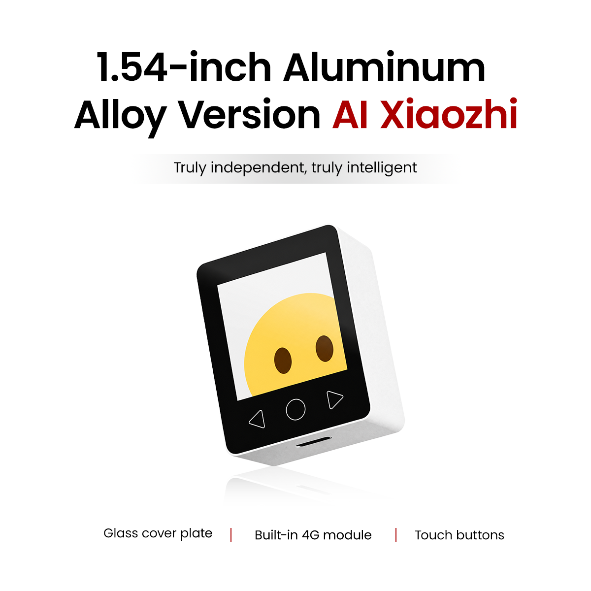
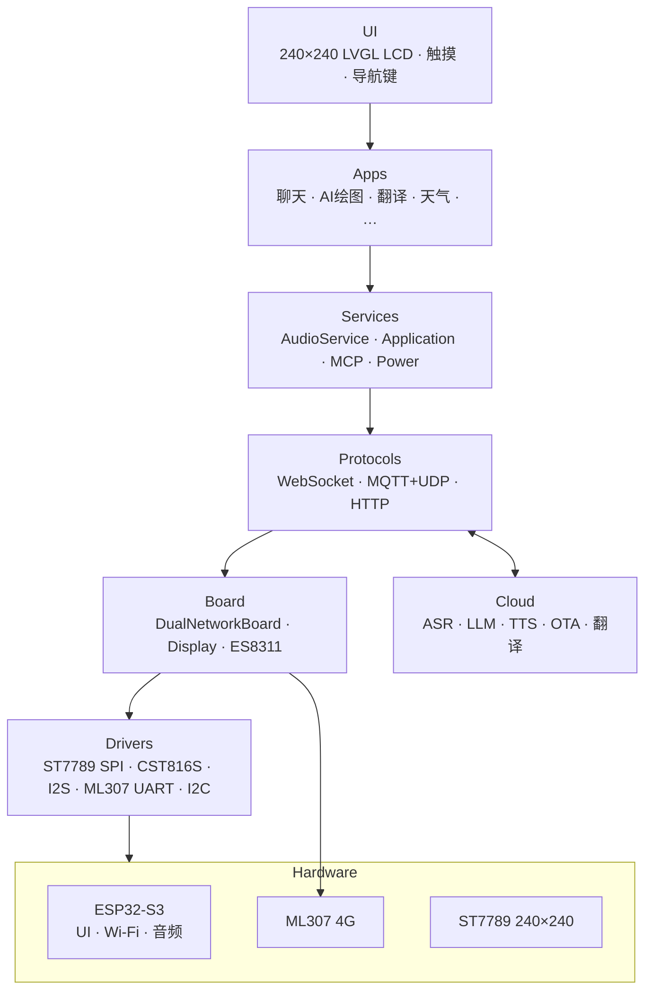
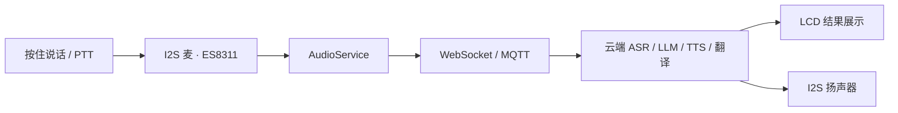
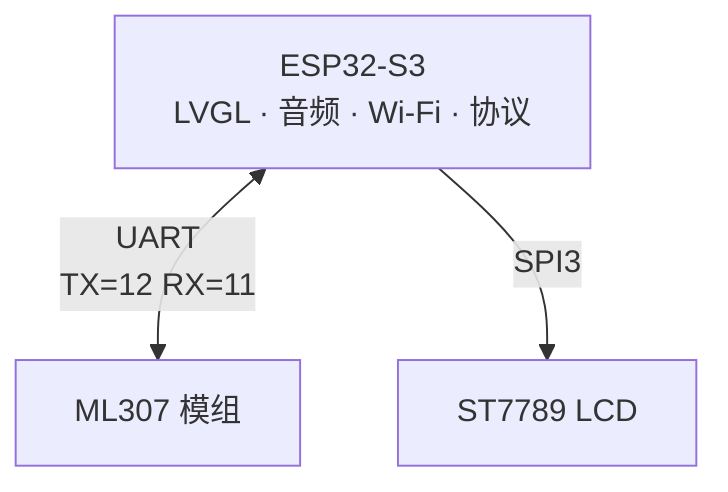

# Metalio-Claw-1.54

<p align="center">
  
</p>

**中文** | [English](README.md)

**快速链接**

- ESP-IDF 官方文档：[ESP32-S3 快速入门 v5.5.4](https://docs.espressif.com/projects/esp-idf/zh_CN/v5.5.4/esp32s3/get-started/index.html)

---

## 目录

1. [产品概述](#1-产品概述)
2. [核心特性](#2-核心特性)
3. [应用场景](#3-应用场景)
4. [系统架构](#4-系统架构)
5. [硬件规格](#5-硬件规格)
6. [网络架构](#6-网络架构)
7. [外设与引脚](#7-外设与引脚)
8. [软件架构](#8-软件架构)
9. [内置应用](#9-内置应用)
10. [通信协议](#10-通信协议)
11. [开发环境](#11-开发环境)
12. [编译与烧录](#12-编译与烧录)
13. [调试与常见问题](#13-调试与常见问题)

---

## 1. 产品概述

**Metalio-Claw-1.54** 是一款面向 AI 助手场景的小型彩屏实体设备。整机搭载 **1.54 寸 240×240** 彩色 LCD（ST7789）、CST816S 电容触控与盖板导航键、ES8311 I²S 音频编解码、片上 Wi‑Fi，以及 **ML307** 蜂窝模组（默认 4G，可切 Wi‑Fi）。固件支持云端语音对话、实时翻译、AI 绘图、天气等主屏应用。

| 属性 | 说明 |
|:---|:---|
| **产品名称** | Metalio-Claw-1.54 |
| **板级标识** | `metalio-claw-1.54`（`BOARD_NAME` / `BOARD_TYPE`） |
| **主控芯片** | ESP32-S3（Xtensa LX7；Flash **16 MB**，Octal PSRAM 8 MB） |
| **屏幕** | 1.54 寸 SPI LCD，240×240，ST7789；CST816S 电容触控 |

板级代码：[`main/boards/metalio-claw-1.54/`](main/boards/metalio-claw-1.54/)。本仓库**仅支持该板型**。

---

## 2. 核心特性

### 2.1 AI 语音交互

- **流式 ASR / LLM / TTS**：经 WebSocket 或 MQTT+UDP 上云
- **唤醒词**：可在 `sdkconfig` 中启用 AFE / Wakenet
- **聊天**主屏应用：语音对话与文本显示

### 2.2 内置应用

- **翻译**：按住说话，流式识别 + 翻译（Sinicloud）
- **AI 绘图**、**天气**、**计算器**、**2048**

天气、翻译和 AI 绘图依赖外部服务；开源配置不包含这些私有接口，需要自行配置后使用。计算器和 2048 可离线使用。

### 2.3 连接能力

- **4G（默认）**：ML307 UART 模组（`DualNetworkBoard`）
- **Wi‑Fi**：ESP32-S3 片上 2.4 GHz；在 **设置 → 网络** 切换

### 2.4 电源与界面

- **电源键**（GPIO47）：短按 / 长按由 `PwrKey` 处理
- **USB 插电检测**（GPIO1）+ 电池 ADC
- 主屏 **待机 / 闲时功耗策略**
- **主题**、亮度、音量、OTA 均在设置中

---

## 3. 应用场景

主屏应用（`home_screen.cc` → `kApps[]`）：

| 应用 | 典型用途 |
|:---|:---|
| **聊天** | 与云端 AI 语音对话与文本显示 |
| **AI 绘图** | 云端文生图 |
| **翻译** | 按住说话实时翻译 |
| **天气** | 天气查询 |
| **计算器** | 本地计算器 |
| **2048** | 本地小游戏 |
| **设置** | 网络、主题、音量、背光、OTA、关于 |

---

## 4. 系统架构



### 4.1 语音 / 翻译数据路径（示意）



---

## 5. 硬件规格

| 类别 | 规格 |
|:---|:---|
| **主控** | ESP32-S3；Flash 16 MB；Octal PSRAM @ 80 MHz |
| **显示** | ST7789，240×240，SPI3，约 40 MHz；背光 GPIO13 |
| **触摸** | CST816S（I2C 0x15，400 kHz）；盖板导航 ◁ ○ ▷ |
| **音频** | ES8311；I²S 24 kHz 输入/输出；功放使能 GPIO21 |
| **网络** | 片上 Wi‑Fi + ML307 4G（UART TX=12 / RX=11） |
| **电源** | USB 检测 GPIO1；维持 GPIO48；电源键 GPIO47；电池 / USB ADC |
| **按键** | BOOT（GPIO0）；电源键（GPIO47） |

---

## 6. 网络架构

板级类为 **`DualNetworkBoard`**：默认走 ML307 蜂窝；可在设置中切换 Wi‑Fi。



| 单元 | 角色 | 接口 | 职责 |
|:---|:---|:---|:---|
| **ESP32-S3** | 主机 | — | UI、音频、Wi‑Fi、协议、MCP |
| **ML307** | 蜂窝 | UART | 默认 4G 数据通路 |

> 在 **设置 → 网络** 切换网络类型；切换后可能需要重启。

---

## 7. 外设与引脚

以 [`main/boards/metalio-claw-1.54/config.h`](main/boards/metalio-claw-1.54/config.h) 为准。

### 7.1 ESP32-S3 GPIO（摘录）

| 功能 | GPIO | 说明 |
|:---|:---|:---|
| I2C SDA | 41 | ES8311、CST816S |
| I2C SCL | 42 | |
| I2S MCLK | 5 | |
| I2S BCLK | 6 | |
| I2S WS | 4 | |
| I2S DOUT | 15 | 扬声器 |
| I2S DIN | 17 | 麦克风 |
| Codec PA | 21 | 与模组供电相关宏共用 |
| LCD MOSI (SDA) | 10 | SPI3 |
| LCD SCLK | 9 | |
| LCD DC | 8 | |
| LCD CS | 14 | |
| LCD RES | 18 | |
| 背光 | 13 | |
| ML307 TX | 12 | 主机 → 模组 |
| ML307 RX | 11 | 模组 → 主机 |
| BOOT | 0 | |
| 电源键 | 47 | `Power_Dec` / PwrKey |
| 电源维持 | 48 | `Power_Control` |
| USB 检测 | 1 | |

### 7.2 盖板导航键（触摸）

面板下方虚拟键（`config.h` 中 `NAV_KEY_*`），一般为 **PREV / HOME / NEXT**（◁ ○ ▷）。

### 7.3 I2C 地址

| 设备 | 7-bit 地址 | 说明 |
|:---|:---|:---|
| CST816S | 0x15 | 触摸 |
| ES8311 | 编解码器默认地址 | 音频 |

---

## 8. 软件架构

固件面向 `metalio-claw-1.54` 硬件。CMake 工程名 `Metalio-Claw-1.54`（版本见根目录 `CMakeLists.txt`，如 `2.0.51`）。

### 8.1 分层

| 层级 | 路径 / 模块 | 职责 |
|:---|:---|:---|
| **入口** | `main/main.cc`、`main/application.cc` | 启动、状态机 |
| **板级** | `boards/metalio-claw-1.54/` | 硬件初始化、引脚、LCD/触摸 |
| **显示** | `display/screen/*`、LVGL 适配 | 各 App、状态栏 |
| **音频** | `audio/` | 编解码、录音 / 播放 |
| **协议** | `protocols/` | WebSocket、MQTT+UDP |
| **MCP** | `mcp_server.cc` | 设备侧工具 |
| **公共** | `boards/common/` | 双网络、电源辅助 |

### 8.2 目录树（摘录）

```
main/
├── application.cc
├── boards/metalio-claw-1.54/   # config.h、ST7789、CST816、电源
├── boards/common/               # DualNetworkBoard、ML307、Wi-Fi
├── display/screen/              # 主屏、聊天、翻译、设置等
├── audio/
└── protocols/

partitions/v1/16m.csv            # 16MB 分区（OTA 5MB×2、resources 5MB）
```

### 8.3 Flash 分区（`partitions/v1/16m.csv`）

| 分区 | 约大小 | 用途 |
|:---|:---|:---|
| nvs / otadata / phy_init | 24K / 8K / 4K | NVS、OTA 元数据、PHY |
| model | 896K | 语音模型（SPIFFS） |
| ota_0 / ota_1 | 各 5MB | 双分区 OTA |
| resources | 5MB | UI 资源（SPIFFS / mmap） |

> `sdkconfig.defaults` 已启用本板自定义分区表。请以 `partitions/v1/` 下实际 CSV 为准。

---

## 9. 内置应用

### 9.0 主屏 App

| 应用 | 说明 |
|:---|:---|
| **聊天** | 语音会话界面 |
| **AI 绘图** | 云端文生图 |
| **翻译** | 按住说话识别 + 翻译 |
| **天气** | 天气页 |
| **计算器** | 本地计算器 |
| **2048** | 本地游戏 |
| **设置** | 见 §9.1 |

系统页（无主屏图标）：开机、待机 / 闲时功耗、OTA 进度等。

### 9.1 设置

| 入口 | 内容 |
|:---|:---|
| **网络** | Wi‑Fi / 4G（ML307）选择与配网 |
| **主题** | 主屏图标主题 |
| **音量** | 扬声器音量 |
| **背光** | 亮度 |
| **OTA** | 固件升级 |
| **关于 / 系统信息** | 型号、芯片、固件版本、内存等 |

---

## 10. 通信协议

| 协议 | 用途 |
|:---|:---|
| **WebSocket** | 流式语音 / 翻译上行 |
| **MQTT + UDP** | 备用语音链路 |
| **HTTP** | OTA、令牌、天气、绘图等 |
| **MCP** | 向大模型暴露设备工具 |

---

## 11. 开发环境

### 11.1 环境要求

| 项目 | 要求 |
|:---|:---|
| **ESP-IDF** | 推荐 **v5.5.4**（已验证；依赖要求 ≥ v5.5.2） |
| **目标芯片** | ESP32-S3 |
| **板型** | Metalio-Claw-1.54（`main/boards/metalio-claw-1.54/`） |
| **操作系统** | Linux / macOS / Windows；下方命令以 Bash 为例 |
| **Python** | 使用 ESP-IDF 安装的 Python 环境 |

### 11.2 安装 ESP-IDF（示例）

```bash
git clone -b v5.5.4 --recursive https://github.com/espressif/esp-idf.git
cd esp-idf
./install.sh esp32s3
. ./export.sh
idf.py --version
cd ..
```

以上为 Linux / macOS 的安装示例。Windows 可使用 ESP-IDF 安装工具，并在 ESP-IDF PowerShell 环境中执行后续命令。

### 11.3 获取源码

```bash
git clone https://github.com/CloudZao/Metalio-Claw-1.54.git metalio-claw-1.54
cd metalio-claw-1.54
```

板型已在 `sdkconfig.defaults` 固定为 `BOARD_TYPE_METALIO_CLAW_1_54`。

---

## 12. 编译与烧录

### 12.1 编译

```bash
. ../esp-idf/export.sh   # 按实际 ESP-IDF 安装位置调整

idf.py build
```

### 12.2 关于 sdkconfig

`sdkconfig` 包含本板的 PSRAM、分区和 LVGL 配置，可通过 `idf.py menuconfig` 调整。默认值由 `sdkconfig.defaults` 提供；板级 `config.json` 供 `scripts/release.py` 使用，直接运行 `idf.py build` 不会自动应用其中的叠加项。

### 12.3 服务接口配置

业务服务地址与路径统一在 `main/cloudzao_endpoints.c` 配置，声明位于 `main/cloudzao_endpoints.h`。天气、翻译和 AI 绘图需要相应服务。地址或路径为空时，这些功能提示“服务地址未配置”；计算器、2048 等本地功能不依赖这些接口。

发布不包含私有服务的版本时，将 `cloudzao_*` 地址与路径置空，保留官方 OTA 地址和激活路径。可运行 `python tests/test_empty_urls.py` 验证配置（需要 GCC/G++）。

### 12.4 烧录与监视

```bash
# 串口按本机修改（Linux 上常见 /dev/ttyACM0 或 /dev/ttyUSB0）
idf.py -p /dev/ttyACM0 flash monitor
```

---

## 13. 调试与常见问题

### 13.1 常见日志 TAG

| TAG | 模块 |
|:---|:---|
| `METALIO_CLAW_1_54` / Board | 板级初始化 |
| `TranslateScreen` | 翻译 |
| `ChatScreen` | 聊天 |
| `Ml307Http` / `Ml307Tcp` | 4G HTTP / TCP |
| `HomeScreen` | 主屏 |
| `LVAdapterDisplay` | LCD / LVGL |

### 13.2 常见问题

**Q：ESP-IDF 版本不对**

使用已验证的 **v5.5.4**，先激活 ESP-IDF 环境再运行 `idf.py`。

**Q：花屏 / 不亮**

1. 核对 `config.h` 中 ST7789 SPI 引脚  
2. 检查背光 GPIO13 与供电  
3. 勿破坏 `sdkconfig` 里 SPI / LVGL buffer 相关项  

**Q：触摸无响应**

CST816S 需在 I2C `0x15` 应答。检查总线 41/42，以及 `config.h` 中坐标镜像配置。

**Q：4G 无网络**

确认 ML307 UART（TX=12、RX=11）、模组供电，以及设置 → 网络为蜂窝；查看 `Ml307*` 日志。

**Q：Wi‑Fi 配网**

设置 → 网络 → 切换到 Wi‑Fi，使用设备界面扫描并连接网络。当前默认固件未启用 BluFi。

**Q：4G 下翻译卡在「停止中…」**

检查蜂窝网络信号及服务接口配置，并查看 `TranslateScreen` 日志。松开按键后，会话应停止录音并结束音频发送。

---

_本文档随 Metalio-Claw-1.54 固件演进。引脚与行为以源码（`config.h`、板级 `.cc`）为准；若文档与硬件不符，欢迎提 Issue。_
